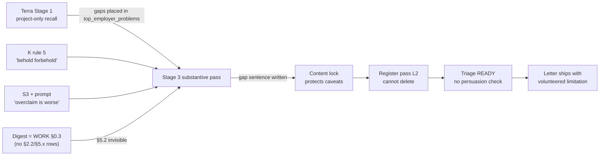

# Batch `rund` — output analysis, harness attribution and optimisation plan

**Run:** `r20260913-205507-247618` (P0.9.3, two-stage route, cluster `rund`, 12 CORE jobs)
**Models (operator-stated):** Stage 1 = Terra (extra high) · Stage 3 = Claude Opus 5 (medium)
**Compared against:** every earlier run in `P0.9/Build/runs/` (Avinor/Huseierne, 0.9.0–0.9.3, incl. the `opusx`/`solxh`/`solmed` branches), the nine-package ranking (`finalized rankings … - Opus 5.md`), the adjudicated master plan, and the curated reference package in `Process/tests/output/final/`.
**Prepared:** 2026-09-14. Nothing in `P0.9/Build` was modified.

---

## 0. TL;DR

1. **Not a failure.** At roughly a quarter (or less) of the earlier wall-clock per job, the batch produced 12 complete, truthful, correctly attributed packages across 12 very different vacancies. No fabrications were found. All 11 rendered packages hit the page budget (CV 2 / letter 1), which three of the nine earlier Avinor packages missed. The template fixes (bold competence block, duplicate letter title) held, and "ikke innført" negative lifecycle claims are gone.
2. **Stage 3 carried the batch.** Opus changed the Stage-1 route or carrying evidence in 12/12 jobs and repaired a Stage-1 *understatement* in 10/12. It never repaired an overstatement. With a cheap Stage 1, the elastic Stage 3 is what made the output usable.
3. **The #1 defect is volunteered limitations.** 10 of 12 letters say what Vegard lacks (e.g. Tieto's *opening*: "Jeg har ikke vært endringsleder eller prosjektleder i fem år"; Amesto: "jeg har ikke ledet et team"; KPMG gives it a whole paragraph). The earlier corpus had this in about 4 of 9 letters. The chain behind it:
   - Terra wrote candidate gaps into `top_employer_problems` in 11/12 strategies. The seven earlier strategies I checked did this 0 times.
   - Stage 3 rules and the prompt treat overclaiming as the worse failure.
   - K rule 5 invites "necessary" caveats.
   - The content lock then *protects* those caveats from the final polish.
   - Triage stayed READY 12/12 regardless.
4. **#2: cross-cutting evidence disappeared.** Communication evidence (§5.2: beslutningsnotater, sammendrag, recipient adaptation) and functional leadership (§2.2) appear in 0 of 12 strategies and effectively 0 of 12 letters. That includes Stortinget ("skrive notater, saksgrunnlag"), KPMG ("rapporter/presentasjoner, storyline") and Nasjonalmuseet ("formidle innsikt"). Five earlier strategies (recorded as Sol-class) cited §5.2 15 times. The cause: Stage 1 went project-only, and Stage 3's digest (WORK §0.3) has no rows for these sections.
5. **#3: the cluster homogenised inside one chat.**
   - "Jeg forteller gjerne mer i en samtale." closes 11/12 letters (0/21 before). This is a side effect of the relaxed closing rule.
   - Five letters open with the same identity sentence.
   - "Det som … er" motivation clefts, and the same "gjennomføringsleder valgte en smalere vei" sentence recur.
   - Adjacent jobs share wording.
   - Stage-1 strategies shrink monotonically over the sequence (17 KB to 9 KB; evidence plan 3 items to 2).
6. **Unchanged residue:**
   - CV/letter repeat the same status sentences.
   - 8/11 headlines wrap to two lines (three-item lists).
   - 5 CV bullets end on "avviklet".
   - Support-section items render **bold** (same defect class as the fixed competence block).
   - DOCX core properties say `Jobbsok_26 P0.9 Soknad for …`, created 2013. The PDFs are clean.
   - KPMG is visibly weaker (4 bullets, gap paragraph, generic close) and its PDFs failed because Word was open during render.
7. **Highest-value fixes are cheap text edits** (§8): gap rule for letters, gap-free positive Stage-1 fields, recall breadth plus digest rows for §2.2/§5.1/§5.2, a varied-close rule, a triage hook for known persuasion defects, and chat segmentation of ≤4 jobs.
   - The Stage-3 and FORFATTERSTEMME edits are **not** in the Stage-1 hash, so they can be tested on a `--from-stage 3` branch that reuses today's strategies.

---

## 1. Run anatomy

### 1.1 Batch and timeline

| # | Job | Priority | Deadline | S1 (context → return) | S3 (context → return) | Render |
|---|---|---|---|---|---|---|
| 1 | Statnett, prosjektcontroller digitalisering | HIGH | 13.09 | 23:06 → 23:10 | 23:25 → 23:29 | OK 2/1 |
| 2 | BI Digital, Business Designer | HIGH | 13.09 | 23:11 → 23:13 (1 mechanical failure) | 23:30 → 23:33 | OK 2/1 |
| 3 | Digdir, prosjektmedarbeider NOBID | HIGH | 13.09 | 23:13 → 23:14 | 23:34 → 23:36 | OK 2/1 |
| 4 | Nasjonalmuseet, seniorrådgiver forretningsutvikling | HIGH | 13.09 | 23:15 → 23:16 | 23:37 → 23:39 | OK 2/1 |
| 5 | Stortinget, seniorrådgiver/rådgiver | HIGH | **14.09 (today)** | 23:16 → 23:17 | 23:40 → 23:42 | OK 2/1 |
| 6 | EIE, systemkoordinator | NORMAL | snarest | 23:17 → 23:18 | 23:43 → 23:45 | OK 2/1 |
| 7 | ECIT, Solution Manager | NORMAL | snarest | 23:19 → 23:19 | 23:46 → 23:48 | OK 2/1 |
| 8 | Tieto, prosjektleder & endringsleder | NORMAL | snarest | 23:20 → 23:20 | 23:49 → 23:51 | OK 2/1 |
| 9 | KPMG, transformasjon og omstilling | NORMAL | snarest | 23:21 → 23:21 | 00:00 → 00:02 | **DEGRADED** (no PDFs) |
| 10 | BearingPoint, forretning/teknologi | NORMAL | snarest | 23:22 → 23:23 | 02:03 → 02:05 | OK 2/1 |
| 11 | Abacus, ERP-rådgiver | NORMAL | snarest | 23:23 → 23:24 | 02:05 → 02:07 | OK 2/1 |
| 12 | Amesto, AI Team Lead | NORMAL | snarest | 23:24 → 23:25 | 02:08 → 02:10 | OK 2/1 |

Times are local and come from handoff/return file stamps. They are a wall-clock proxy, not token counts. After the first job, Stage 1 took **about 1 minute per job** and Stage 3 **about 2 minutes per job**. Comparable earlier 0.9.3 runs took about 7–8 minutes per Stage-1 job and 5–11 minutes per Stage-3 job (`b5104f`, `0fa53b`).

**Anomalies worth knowing:**

- **BI, Stage 1:** a hallucinated evidence ID (`EV:WORK#021-4-2-tverrorganisatorisk-power-bi`, missing `prj-02-`) was rejected. The single mechanical correction fixed it. The harness worked as designed.
- **KPMG:** Stage 3 ran after a 9-minute pause, as the 9th job in the chat. It is stylistically different from the other eleven:
  - Norwegian `writer_note` (all others are in English).
  - No `upstream_claim_repaired`.
  - 4 CV bullets and no BAR override.
  - 6 competencies.
  - A gap paragraph and the generic FORFATTERSTEMME-flagged close.
- **Session break:** a 2-hour gap (00:03 → 02:02) and `Opus_med.zip` (02:01, a snapshot through KPMG) show that Stage 3 was interrupted. It then resumed for jobs 10–12.
  - A second KPMG `FINAL_AND_REVIEW` handoff (02:02, prior final present) was created but never returned, so the 00:03 KPMG final is current.
  - I cannot tell from disk which model and effort wrote jobs 9–12. Jobs 10–12 read like jobs 1–8; KPMG does not.
- **KPMG PDFs:** Word COM failed ("Retrieving the COM class factory…"). Word owner files (`~$knad_…docx`, BI 23:46 and Nasjonalmuseet 23:56) show Word was open for review during the render. The DOCX files are valid.
- **Inbox:** three PDFs were not in the batch CSV:
  - "Are you our new Senior Manager Digital Governance Operations" (English; would be EXCEPTION).
  - "Vil du bygge produkter som frigjør tid …"
  - "Vil du være bindeleddet mellom teknologi, forretning og styring".

### 1.2 Provenance defect: the manifest records the wrong models

`manifest.settings_snapshot.stages` says `stage1 = SOL_CLASS`, `stage3 = SOL_CLASS`, `SOL_CLASS = "Codex / GPT-5.6 Sol"`. Neither stage ran that model.

- The manifest is the only durable record of which model produced a run, so any budget-tier comparison built from disk alone will be wrong.
- The same stale mapping is recorded on **every** earlier run, including the `stage3_opusx` branch, which was not Sol either. The problem is long-standing, not new.
- `settings.py` already accepts `TERRA_CLASS`. The correct entry would have been `stage1 = "TERRA_CLASS"`, `TERRA_CLASS = "Terra (xhigh)"`, `SOL_CLASS = "Claude Opus 5 (medium)"`.
- `configured_model` is folded into `stage_policy_sha256` (`manifest.py:181-199`). Correcting it *after* freeze and branching will mark strategies stale. Set it right before the next freeze.

### 1.3 Vacancy set versus earlier runs

Every earlier run used the same two vacancies (Avinor digital transformasjon, Huseierne strategi/målstyring). Both are close to Vegard's strongest route (gevinst/styring/digital gjennomføring).

`rund` is a deliberately harder, "IRL" spread:

- one near-perfect fit (Statnett controller);
- several good-but-stretched fits (Stortinget, BI, ECIT, Abacus, Amesto, BearingPoint);
- several structural stretches: Tieto (5-year minimum), KPMG (consulting and nedbemanning), Digdir (eID domain), Nasjonalmuseet (audience/commercial domain) and EIE (real-estate systems).

Much of the gap-handling pressure therefore comes from the vacancies, not only the harness. §5 separates the two.

---

## 2. What changed in the harness before this run

Between the last 0.9.3 run (`0fa53b`, frozen 09-08) and this run, the frozen inputs differ only in:

- the two stage instructions;
- the three writing policies;
- `settings.toml` (`[voice]`);
- the two masters plus `template_map.json`.

Plus live `cli.py`, `settings.py` and `prepare_masters.py`. Authorities, schemas, the evidence index, the baseline map and the personality inputs are byte-identical.

This is the adjudicated master plan (M01–M06) as implemented; Cluster B (the K correction) was included.

| Plan item | Frozen edit (verified by diff) | Intended effect | Observed in `rund` |
|---|---|---|---|
| **M01** material-question allocation | S1: compound-requirement rule, "identify employer questions the pair leaves unanswered", "headcount alone establishes scale". S3 step 5: read pair against requirements, repair missing high-value answers; review omission note. D: "Begrunnelsen er arbeidsgiverens beslutning, ikke telling". | Broader, reasoned coverage (communication, facilitation) | **Partly, with side effects.** Coverage breadth is fine (9–15 refs), but it arrives as bolt-on "også" sentences at paragraph ends. §5.2 communication was never retrieved (§5, T2). S1 used "retain the gap" to put gaps into positive fields (T1). |
| **M02** substantive pair edit before lock | S3: complete pair edit; CV establishes scope, letter explains; check whole claims and version joins | Less CV/letter duplication; correct joins | **Joins: yes** (2026/2027, PRJ-04 vs PRJ-06 kept apart everywhere). **Duplication: no change** (verbatim status sentences in both documents in most packages). |
| **M03** K correction (E08–E10) | Unknown ≠ absent; clause-level gap rule; strongest verb kept; "Behold et uttrykkelig forbehold når …" | No "ikke innført"; no redundant mandate clauses | **"ikke innført": fixed (0).** Strong verbs kept. **Gap clauses: worse**: 10/12 letters, several on advertised requirements (T1). |
| **M06** defensible fit, headline role, ordinary close | D: name-swap test relaxed; headline names occupational function, not a list. V: a short natural invitation is enough | Less forced uniqueness; cleaner headline and close | **Forced uniqueness: gone.** **Headline: no change** (8/11 wrap, 3-item lists). **Close: over-corrected** to one stock sentence, 11/12. |
| **M04** register dial (level 2), final pass only | V: operator register section; S3: defer V to content lock; `final_polish` in bundle | Soften self-ranking, repeated positioning, conflict framing | **Small effect.** Conflict framing fell from 8/21 to 4/12 letters. No self-ranking. Cannot touch volunteered caveats, which the lock protects. |
| **M05** masters and consumers | Competence run un-bolded; letter title once; reference below the address table; older-role chain released | Scannable CV top; clean letter header | **Worked.** Label emphasis lost as predicted. **Support-section items are still bold** (same defect, other runs). |

---

## 3. Verdict

### 3.1 Should the new harness be judged a failure?

No. The fair question is whether the harness keeps its non-negotiables and produces send-ready material at low cost when the models are cheaper. On that question the result is a qualified success.

- **Hard boundaries held everywhere.** Truth, attribution, lifecycle, identity and dates held in every package. The confirmations from 09-06 are consistently used: "i praksis eneste (kodende) utvikler", "2026 og 2027", "ferdigstilt og overlevert til controllere tidlig i 2026", the KI-superbruker role.
- **Mechanics were better than the high-budget corpus.** Nothing overran a page and nothing broke. Where a PDF was missing, the cause was operational.
- **Routing per vacancy was sensible and varied.**
  - Statnett: month close and project economics.
  - ERP: REGERP tooling.
  - EIE: KI superuser plus Sector Alarm customer dialogue.
  - Stortinget: the two staff-unit placements.
  - ECIT: bounded lifecycle ownership.
  - BI: the STE model as business design.
- **Several letters show real judgement and a spine** (BI, Amesto, BearingPoint, ECIT, Statnett), with "put the decision in the verb" moves (avviste / gikk bort fra / gjorde om bestillingen).

What cost the most interview value is tone and calibration in the letter, plus evidence recall. Both are concentrated, traceable and cheap to address (§8).

### 3.2 Scorecard against the earlier corpus

Earlier runs = 16 Avinor/Huseierne packages from 0.9.0–0.9.3 at near-unlimited budget (plus the human-curated reference). The vacancy sets differ, so read each row as a harness property, not a head-to-head score.

| Property | Earlier corpus | `rund` | Direction | Main owner |
|---|---|---|---|---|
| Fabrications / unsupported facts | 0 found (nine-package audit) | 0 found (full read, 12 packages) | = | Authorities + K + S3 |
| Page budget met (rendered) | 6/9 Avinor packages clean | 11/11 | ↑ | S3 discipline + M05 |
| Evidence breadth (`used_evidence_refs`) | 7–23 (Avinor mean ≈ 13) | 9–15 (mean 12.7) | = | S3 |
| Stage-1 depth (evidence-plan items / positive "role" words) | 4–9 / 129–897 | 2–3 / 32–84 | ↓↓ | S1 model |
| Stage-1 personality facets | 1–3 per job | 0 in 11/12 | ↓ | S1 model |
| Stage 3 overriding Stage 1 | frequent | 12/12 (10 understatement repairs) | ↑ elasticity needed | S3 elasticity |
| Letters volunteering a limitation | ~4/9 Avinor | **10/12** | ↓ | S1 fields → S3 rules → K5 → lock |
| Communication/decision-note evidence (§5.2) used | cited 15× across 5 earlier strategies | **0** | ↓↓ | S1 recall + S3 digest |
| Identical close across the cluster | 0/21 "forteller gjerne mer" | **11/12** | ↓ | V closing edit + one-chat sequencing |
| Identity-formula openings | ~10/21 | 5/12 | = | S3 / V |
| "Gjennomføringsleder valgte …" conflict framing | 8/21 | 4/12 | ↑ | V register (partial) |
| "ikke innført"-type negative status | 2 instances | 0 | ↑ | K M03 |
| Headline wraps to 2 lines | 5/5 checked | 8/11 | = | S1 hypothesis pattern + D (soft) |
| CV/letter duplication (share of letter 5-grams also in CV) | 0.02–0.12 (mean ≈ 0.07) | 0.05–0.15 (mean ≈ 0.10) | ↓ slightly | S3 (M02 ineffective) |
| Triage distribution | READY with one CHECK | READY 12/12 | uninformative | S3 triage table + prompt |

---

## 4. Package-by-package review

Each package was read in full: final JSON, rendered PDF text, review and strategy. Every material claim was checked against the frozen authorities, and each package was read against its vacancy (derived view checked against the source PDF). Ad text is paraphrased below. Suggested wording is a starting point: it is supported by the cited sections, but Vegard owns the final Norwegian.

**Verdict scale**

- **Send after light edit:** under 10 minutes, sentence-level.
- **Targeted edit:** 10–30 minutes, one or two paragraphs or bullets.
- **Rework:** re-run Stage 3 or rewrite substantially.

### 4.1 Statnett — Prosjekt controller digitalisering (HIGH, deadline 13.09)

**Vacancy essence:** a master in economics or technology, controlling experience, and accounting/process understanding. The work is budget, forecast and actual-spend follow-up with project leaders, plus developing methods and tools. IT-contract framework follow-up is a named task; IT/digitalisation finance is an advantage.

**Route:**
- S1 chose PRJ-03 plus BAR as a controller-near route.
- S3 kept the route but put BAR's month close and project economics first, added PRJ-10 DRG forecasts (for the forecasting requirement, which S1 missed) and PRJ-06 as a short judgement unit.
- This is the best-fitting route of the batch.

**Strengths**
- Correct occupational anchor: "Samfunnsøkonom | Økonomioppfølging, budsjett og prognoser" fits on one line.
- Competencies are concrete ("Månedsoppgjør: periodisering, avsetninger og avstemming").
- No gap sentence. IT contracts and portfolio responsibility are correctly left out of the text and kept in the review.
- The PRJ-06 paragraph opens with a real judgement sentence ("Å kvalitetssikre en økonomisk analyse handler ofte om hva datagrunnlaget faktisk bærer") and puts the decision in the verb ("gikk bort fra den direkte fordelingen").

**Defects**
- **Opening is a formula**, and it labels the candidate's own profile: "Jeg er samfunnsøkonom og rådgiver økonomi og IKT … Den kombinasjonen er grunnen til at jeg søker". It also restates the title printed directly above.
- **Closing uses the cleft plus employer-purpose pattern** that V pattern 3 names ("Det som gjør stillingen aktuell for meg, er at … investeringene skal gi et mer robust kraftsystem"), then the stock close.
- **Heavy CV/letter duplication.** 7 letter sentences have ≥0.6 similarity to a CV sentence. The month close is almost verbatim in both documents. The budget-tool paragraph repeats the CV's whole inventory (20 år, 50 personer, 80 prosent, differanse/akseptanse/risikoregister, opplæring, 2026/2027). "Modellen ble ferdigstilt og overlevert til controllere tidlig i 2026" appears in both.
- The letter runs 415 words: a full page with no breathing space.
- The CV dashboard bullet ends "…til dashbordet ble avviklet rundt februar 2026".
- **Missed evidence:** WORK §5.2 decision notes and recipient adaptation, which would answer the communication requirement.

**Verdict: send after light edit.** The strongest package of the batch.
- Replace the opening with a sentence that states the offer (e.g. "Jeg har arbeidet på begge sider av økonomioppfølgingen ved Oslo universitetssykehus: i selve oppgjørs- og budsjettarbeidet, og med verktøyene det går gjennom."), then go straight to the month-close paragraph.
- In the letter, cut the budget-tool inventory to the decision and implication: which data were integrated, why the narrow refactor, what controllers got. Leave the numbers to the CV.
- Replace the closing's first sentence with the concrete contribution sentence that already follows.
- CV dashboard bullet: "…i drift fram til februar 2026".

### 4.2 Handelshøyskolen BI Digital — Business Designer (HIGH, deadline 13.09)

**Vacancy essence:**
- A very experienced strategic adviser who bridges business, technology, design and process.
- Titles explicitly do not matter.
- The work: process design and value-chain analysis, data flows, facilitation, and business design (costs, benefits, whether to build).
- Lean canvas and modern product methods are advantages.

**Route:**
- S1 chose requirements/intake design (PRJ-09/08, labelled lifecycle CONCEPT) as carrying evidence and parked PRJ-06 as a counterfactual.
- S3 correctly reversed this. PRJ-06 now carries "business design": cost/benefit and building differently from what was ordered. PRJ-03 carries system mapping under constraint. PRJ-08/09 and user tests move to a supporting paragraph.
- A clear example of elasticity adding value.

**Strengths**
- The best opening of the batch, in medias res: "Da jeg skulle fordele gevinstene … ble det avgjørende spørsmålet om datagrunnlaget i det hele tatt bar en slik fordeling. Det gjorde det ikke, og svaret ble en annen løsning enn den som var bestilt."
- The judgement content is excellent: indirect figures not presented as observed use; the VBA-free core so controllers can adjust; the option appraisal; the recommended broader restructuring.
- Facilitation is shown with recipients: user tests, observation of confusion, improvement rounds, cross-organisation teaching.

**Defects**
- **Vocabulary stretch:** "Kartlegging av et systemlandskap har jeg gjort i praksis med budsjetteringsverktøyet". To a BI hiring manager, a *systemlandskap* is an enterprise landscape, and an Excel/VBA workbook reads as an unconvincing equivalence (K: employer vocabulary only where covered).
- **Contrast clause about title:** "Min erfaring er fra et sykehus og ikke fra en tittel som business designer". This is mild because the ad itself says titles don't matter.
- **Conflict framing:** "…mens gjennomføringsleder valgte en smal refaktorering".
- "Dette arbeidet skjer sammen med folk som ser problemet fra ulike ståsteder" is an announced bridge.
- The closing uses the cleft "Det som trekker meg mot stillingen, er …" and repeats the ad's task list back.
- 486 words: the longest letter, which fills the page.
- The headline wraps to two lines.
- **Missed:** §5.2 recipient-adapted communication, which the ad asks for directly.

**Verdict: targeted edit.** A high-ceiling letter.
- Replace the *systemlandskap* sentence: "Hvordan logikk, data og manuelle steg faktisk henger sammen i en løsning i drift, har jeg kartlagt i budsjetteringsverktøyet …"
- Drop "mens gjennomføringsleder valgte" in favour of "Rammen ble en smal refaktorering …".
- Cut the bridge sentence opening paragraph 3.
- Shorten the headline to "Samfunnsøkonom | Prosess, dataflyt og forretningsdesign".

### 4.3 Digdir — Prosjektmedarbeider NOBID (HIGH, deadline 13.09)

**Vacancy essence:**
- Coordinate a Nordic-Baltic eID cooperation under the Nordic Council of Ministers.
- Minimum requirements: degree, multi-organisation processes, English and Scandinavian.
- Desired: identity-management knowledge, cross-border eID, strategy and target pictures.
- The role includes running meetings and workshops in English for professional and political groups, and travel.

**Route:**
- S1 again chose PRJ-08/09 (CONCEPT) and marked the multi-organisation minimum as ADJACENT.
- S3 replaced this with PRJ-04 (team-developed, hospital-wide standard, still in use ~2.5 years) and PRJ-03 (50-person process). Workshops, cross-organisation teaching and English (Calgary) are support.
- A good repair.

**Strengths**
- The minimum is answered with implemented, multi-actor outcomes.
- English is evidenced, not asserted: "gikk på videregående skole i Calgary".
- The closing offer is specific to the role: activity planning, prepared meetings and workshops, progress reporting.

**Defects**
- **A whole paragraph about the gap:** "eID, identitetsforvaltning og nordisk samarbeid har jeg ikke arbeidet med." It is followed by a month-close learning-speed anecdote (weak relevance to eID cooperation) and a humility sentence: "Jeg regner med å måtte bruke den første tiden på å lære aktørene og regelverket godt."
  - The domain gap is a *desired* item and visible anyway.
  - The paragraph spends 67 words on it and adds no argument.
- Opening "Jeg søker stillingen … fordi …" is serviceable. The closing uses the cleft "Det som gjør NOBID meningsfullt for meg, er …" plus the stock close.
- **Weak CV headline:** "Samfunnsøkonom og rådgiver | Samarbeid på tvers av fagmiljøer og digitalisering". "Samarbeid" is a soft skill, not an occupational function, and the line wraps.
- **Review nudge:** "Vurder om søknaden er verdt å sende gitt domenegapet" asks the human to reopen the apply decision, which DEC-31 forbids.

**Verdict: targeted edit.**
- Delete paragraph 4. If a domain line is wanted, convert it in the same sentence, e.g. "Identitetsforvaltning blir et nytt fagfelt for meg; å få mange aktører til å stå bak én felles løsning er det ikke."
- Use the freed space for one coordination example with a recipient.
- Headline: "Samfunnsøkonom og rådgiver | Koordinering og felles løsninger".

### 4.4 Nasjonalmuseet — Seniorrådgiver forretningsutvikling (HIGH, deadline 13.09)

**Vacancy essence:**
- A new senior role, owning professional responsibility for audience-oriented business development in the commercial department.
- Minimum experience is an either/or list: audience development, target groups, business development, analysis *or* strategy work.
- Also: qualitative and quantitative insight methods, clear communication of insight, building method, and being a sparring partner.

**Route:**
- S1: PRJ-04 method plus PRJ-06, with the experience minimum marked ADJACENT, although one listed alternative (analysis) is fully met.
- S3 repaired that understatement, tied PRJ-04 to follow-up of initiatives (BAR tiltak) and merged the dashboard user tests with PRJ-06 into one "insight made usable" unit.

**Strengths**
- The method paragraph is well aimed: "Metodeverket jeg kjenner best fra innsiden, er sykehusets rammeverk …", with the four-person team kept and adoption and durability correctly stated.
- Qualitative methods are not inflated: the review notes that only user tests and observation exist.

**Defects**
- **The closing concedes the domain with humility:** "Publikumsutvikling, medlemskap og inntektsarbeid i en kulturinstitusjon blir nytt for meg, og der vil jeg lære mye av kollegene i seksjonen." This touches the ad's own first-listed experience alternative and its core tasks, and V explicitly bans humility phrases.
- **Opening restates the employer's situation back to them** ("fordi dere skal gjøre arbeidet … mer strukturert og innsiktsbasert"), after the identity formula.
- **Communication, the role's core skill, uses no communication evidence.** §5.2 (decision notes, executive summaries, recipient-adapted depth) was the most relevant evidence available.
- Duplication: 7 sentences ≥0.6 similar to the CV; the adoption sentence and the handover sentence appear in both.
- Paragraph 3 ends on a bolted-on education sentence.

**Verdict: targeted edit.**
- Delete the humility sentence.
- Add one §5.2 sentence, e.g. "Til ledere, controllere og fagmiljøer skriver jeg beslutningsnotater og korte sammendrag der detaljnivået følger mottakeren."
- Replace the opening with the method sentence.

### 4.5 Stortinget — seniorrådgiver/rådgiver, forvaltningsavdelingens stab (HIGH, **deadline 14.09 = today**)

**Vacancy essence:**
- A central staff role close to the department head and management group.
- The work: planning and follow-up structures (Decisions/Planner), gatherings, cross-cutting coordination, notes and decision support, investigations, and new digital/KI working methods.
- Requirements: leader-support and staff experience, organisational understanding, Norwegian/English, digital tools.
- Advantages: M365, guidance of staff, continuity/security/preparedness. HEMMELIG clearance is required.

**Route:**
- S1 said there was no formal staff role and put PRJ-08/09 first.
- S3 caught a real fact S1 missed: both OUS placements are formal staff units (Barne- og ungdomsklinikken, Stab; Direktørens stab, Analyseavdelingen). It anchored the package there and promoted the KI-superbruker role because the ad names KI explicitly.

**Strengths**
- The staff-unit anchor is correct and valuable: "Jeg har arbeidet i stabsenheter ved Oslo universitetssykehus siden 2023".
- No gap sentence; Decisions/Planner and HEMMELIG are left to the review.
- The closing offer is concrete (ryddige saksgrunnlag, simple follow-up structure, sober KI use).

**Defects**
- **Source documentation voice in both documents:** "I klinikkstaben fikk jeg oppgaver etter behov og etter hva økonomileder hadde kapasitet til". This boundary phrasing, lifted from the authority, reads as if Vegard got leftovers (K: do not carry the source's documentation voice).
- **The CV leads with KI:** bullets 1–2 are the superuser role and a KI working-method bullet. The latter ends in pipeline register ("med mennesket som ansvarlig for det som leveres").
  - OTHER §3.4 `AI_NOVELTY_BIAS` warns exactly against this when a more direct requirement (staff work, decision support, notes) exists.
- **The biggest single miss of the batch:** the ad's writing tasks (notater, saksgrunnlag, beslutningsstøtte) are answered only with "beslutningsgrunnlag for ledere". §5.2 decision notes and executive summaries exist and are not used.
- **Bolt-on:** the KI paragraph ends with an unrelated budget-tool training sentence.
- **Headline is 99 characters and wraps:** "Samfunnsøkonom og rådgiver i stab | Beslutningsgrunnlag, arbeidsprosesser og digitale arbeidsformer".
- The closing uses the cleft "Det som trekker meg mot stillingen, er …", then the stock close.

**Verdict: targeted edit. Do it today.**
1. Body 1, first sentence: "I klinikkstaben tok jeg økonomiske avklaringer og saker etter behov, fra oppfølging av ekstern finansiering til prosjektavslutning." Same edit in the CV bullet.
2. Add to body 2 or the closing: "Til ledere, controllere og fagmiljøer skriver jeg beslutningsnotater og korte sammendrag, med detaljnivå etter mottaker." In the CV, add "Utarbeider analyser, beslutningsnotater og sammendrag for ledere, controllere og fagmiljøer" as bullet 1 or 2.
3. Move the two KI bullets below PRJ-08/PRJ-04, and cut "med mennesket som ansvarlig …".
4. Headline: "Samfunnsøkonom og rådgiver i stab | Beslutningsgrunnlag og arbeidsprosesser".
5. Letter subject line: capitalise the title ("Søknad: Seniorrådgiver/rådgiver"). This is operator batch data.

### 4.6 EIE eiendomsmegling — Systemkoordinator (NORMAL)

**Vacancy essence:**
- Broker-facing system support: inquiries, fixes, follow-up.
- Work with the tech company Brokio: testing tools and system direction.
- A large KI share of the work.
- Guides people actually read, training both online and at gatherings, office set-ups with vendors, and an overview of Core/EIE 365.
- Background: estate agent, or economics/IT, plus system work and close customer dialogue.

**Route:**
- S1: PRJ-03 plus technical guidance, with KI as a supplement, and it missed customer dialogue.
- S3 led with the KI superuser role (the closest documented analogue to handling system inquiries), the governed coding-agent structure, the REGERP tools as multi-user system change, and Sector Alarm for the customer-dialogue minimum.
- A strong, creative and truthful re-route.

**Strengths**
- The best fit of content to an unusual role.
- The opening gets to the point in one sentence.
- The KI paragraph shows method and a stance that fits brokers: find where KI actually saves time, and be clear where a human must check.
- The customer-dialogue minimum is met with real evidence instead of an internal-user stretch.

**Defects**
- **Closing opens with a learning need:** "Meglerbransjen, Core og EIE 365 må jeg lære …". It is framed as a plan (time with brokers and Brokio), so it is the least costly of the batch, but it still names listed systems as unknown.
- CV bullet "Satte opp arbeidsstrukturen for KI-kodeagenter" is defensible (OTHER §4.3, WORK §4.5) but reads technical for this audience. The ad asks for user-facing guides, so onboarding and guide-writing deserved the second slot.
- Stock close. The headline wraps.

**Verdict: send after light edit.** Recast the closing opener as action: "Den første tiden vil jeg bruke tett på meglerne og Brokio, for å lære Core, EIE 365 og arbeidshverdagen deres."

### 4.7 ECIT — Solution Manager, Commercial (NORMAL)

**Vacancy essence:**
- The bridge between business and IT for commercial systems (CRM, e-signing, websites): lifecycle, roadmap, projects from idea to delivery, prioritising needs, steering meetings, KPIs, change activities.
- 3–5 years in project management or system/process development.
- Vendor or contract follow-up is an advantage.
- Ask "why" before "how".

**Route:**
- S1 said lifecycle ownership was undocumented and put PRJ-09/08 first.
- S3 found that PRJ-01 *was* a formal lifecycle ownership: owner Aug 2025–Feb 2026 with monthly operation, backlog, user tests and sprints.
- S3 then built "lifecycle → requirements under constraint (two rounds, 2027 with more freedom) → why-before-how (PRJ-06)".

**Strengths**
- The lifecycle unit includes a genuine product-management judgement from the source: "Da grensene i datamodellen begynte å skape leveranserisiko, skilte jeg en større modernisering ut fra de løpende utvidelsene."
- "Ikke alle bestillinger bør løses slik de er formulert" lands on the ad's why-before-how.
- The 2027 round with more freedom is used correctly.

**Defects**
- **Closing opens with a gap statement on listed tasks:** "CRM, nettsider, signeringsløsninger og oppfølging av leverandører har jeg ikke arbeidet med, og det er der jeg må lære mest." The ad says there is no single perfect background; the sentence buys nothing.
- **Paragraph 1 ends on decommissioning:** "Dashbordet ble avviklet rundt februar 2026." A deflating final beat for the unit that carries the lifecycle argument.
- Conflict framing ("mens gjennomføringsleder valgte …").
- Bolt-on sentence ending paragraph 3 (Scrum/Kanban/WIP).
- English terms "backlog" and "sprinter" in both documents. Common in the Norwegian IT trade, so acceptable here.
- Stock close; the headline wraps.
- **Missed:** §5.2 recipient adaptation. The ad asks for communicating with technical specialists and top management alike.

**Verdict: targeted edit.**
- Delete the gap sentence.
- Move the decommissioning into the period ("…fra om lag august 2025 til løsningen ble faset ut i februar 2026").
- Swap the WIP bolt-on for one §5.2 sentence about adapting depth for managers versus technical teams.

### 4.8 Tieto Tech Consulting — Prosjektleder & Endringsleder (NORMAL)

**Vacancy essence:**
- Lead change and adoption in client digitalisation and transformation.
- "Maybe you have worked as change lead, project lead, process lead *or adviser*."
- Stakeholder trust and benefit realisation; KI-supported work processes.
- A minimum of five years as change, process or project lead.
- Public-sector and/or large private experience is described as a *strength*.
- Certifications are advantages.

**Route:**
- S1: PRJ-03 plus PRJ-08; it framed "the clear minimum gap" as one of the top employer problems.
- S3 rebuilt around the ad's named outcomes: benefit realisation (PRJ-04 + PRJ-06), adoption (PRJ-03 + REGERP tools) and KI work processes (superuser + governed workflow).
- Good selection.

**Defects (the most costly letter of the batch)**
- **Self-disqualification in the opening paragraph:** "Jeg har ikke vært endringsleder eller prosjektleder i fem år. Jeg søker likevel, fordi …" This is the most valuable position in the letter, spent on a knockout cue.
  - The authorities provide the positive route: WORK §6.6 functional change leadership; OTHER §2.5 functional change route (workshops, onboarding, user observation, adoption); WORK §2.2 safe functional-leadership signals.
  - The ad itself accepts "rådgiver".
- **Closing restates a strength as a limitation:** "Erfaringen min er fra offentlig sektor, og jeg har ikke jobbet som konsulent." The ad names public-sector experience as an asset.
- **Closing moral in the KI paragraph:** "Det gir et realistisk bilde av hva KI kan overta …"
- Headline wraps ("… | Innføring, gevinstrealisering og KI-støttede arbeidsprosesser").
- **Review:** "spørsmålet er om søknaden skal sendes" reopens the apply decision (DEC-31) instead of repairing the opening.

**Verdict: targeted edit. The highest-return edit in the batch.**
- Replace the last two opening sentences with a positive frame, e.g. "Mye av arbeidet har handlet om å få nye løsninger og felles metoder tatt i bruk, ikke bare utviklet, og det er den delen jeg vil arbeide mer med hos dere."
- Recast the closing's first sentence as the asset: "Erfaringen fra en stor offentlig virksomhet tar jeg med inn i kundeoppdragene: …"
- Delete the KI moral.

### 4.9 KPMG — Konsulent, transformasjon og omstilling (NORMAL)

**Vacancy essence:**
- Strategic transformation, reorganisation, profitability and nedbemanning for large clients.
- 2–10 years of transformation or organisational development *either* at a consultancy *or* through strategic work in larger organisations.
- Project leadership, analysis, reports/presentations with a storyline, implementation and benefits, sales.
- The ad asks for a CV that highlights project experience with concrete examples and results.

**Route:**
- S1: PRJ-04 + PRJ-03 (+ PRJ-08); consulting, PM, nedbemanning and sales marked as gaps.
- S3 swapped PRJ-08 for PRJ-06 as the "no ready recipe" signal.

**Strengths**
- Three well-bounded units.
- Truthful status and attribution.
- "avviste jeg falsk presisjon" puts the decision in the verb.

**Defects (a clear quality dip against jobs 1–8 and 10–12)**
- **Entire gap paragraph:** "Jeg kommer ikke fra et konsulenthus og har ikke hatt formell prosjektlederrolle eller arbeidet med nedbemanning og salgsprosesser."
  - The ad explicitly accepts strategic work in larger organisations as the alternative path.
  - The paragraph's second sentence is the positive frame. It should have stood alone.
- **Two lesson/moral sentences:** "Arbeidet lærte meg verdien av …"; "Det er denne typen problem jeg gjerne vil arbeide mer med hos KPMG".
- **Generic close of exactly the kind V pattern 1 flags:** "Jeg tar gjerne en samtale om hvordan denne erfaringen kan brukes i KPMGs …"
- **Thinnest CV of the batch:**
  - 4 bullets; the BAR override is absent, so baseline defaults are used.
  - 6 competencies, profile of 44 words.
  - No §5.2 evidence, although the ad centres reports, presentations and storyline.
  - "Moderniserte et arvet … verktøy" edges toward whole-modernisation ownership (the next sentence limits it).
- Headline casing is inconsistent (lowercase after the pipe; invisible when rendered in caps).
- **No PDFs** (Word COM failure).

**Verdict: rework.**
- Cheapest: re-run Stage 3 for KPMG in a fresh chat (`branch --from-stage 3`), which reuses the current strategy.
- Manual alternative:
  - Delete the gap paragraph's first sentence.
  - Replace both morals.
  - Add a BAR override and a §5.2 bullet ("Utarbeider beslutningsnotater, sammendrag og presentasjoner for ledere …"), borrowing bullets already written for Statnett.
  - End on a specific offer.
- Close Word, then run `render`.

### 4.10 BearingPoint — Konsulent forretning- og teknologirådgivning (NORMAL)

**Vacancy essence:**
- 2–4 years of experience, preferably as a consultant; a master is required.
- Technology and AI for business value, digital transformation, governance models, change and AI adoption, procurement and IT-partner selection.
- Work close to leadership and challenge established truths; Norwegian and English.

**Route:**
- S1: PRJ-03 + PRJ-06 + KI.
- S3 kept it and added PRJ-05 (challenging the forecast target, requiring time-aware validation) plus the option appraisal and recommended restructuring, as evidence of challenging assumptions. It also added the ongoing KI master and superuser role for an AI-heavy employer.
- Well matched.

**Strengths**
- A strong spine in the opening: three questions where technology and economics must be judged together.
- The PRJ-05 paragraph shows distributed authorship honestly ("Koden skrives av meg, en kollega og kodeagenter").
- The minimum (master and 2–4 years) is correctly treated as met (OUS since March 2023).

**Defects**
- **The closing concedes a preferred qualification and listed tasks:** "Jeg har ikke jobbet som konsulent, og anskaffelser og valg av IT-partnere blir nytt for meg." The month-close learning-speed sentence that follows is a decent bridge by itself.
- "Gjennomføringsleder valgte en smalere vei." (conflict framing).
- Carry-over from the adjacent Amesto letter: highest pairwise 4-gram similarity in the batch (0.14). The superuser + UiA sentence and the restructuring sentence are near-identical.
- Stock close.

**Verdict: send after light edit.**
- Delete the concession sentence and keep the learning-speed evidence: "Nye fagområder setter jeg meg raskt inn i: i staben til Barne- og ungdomsklinikken hadde jeg overtatt hele den tildelte månedsoppgjørsflyten innen om lag tre måneder."
- Neutralise the implementation-lead sentence.

### 4.11 Abacus IT — ERP-rådgiver (NORMAL; the ad covers junior and senior)

**Vacancy essence:**
- BNXT (Visma) implementations for customers.
- Junior: 1–2 years of ERP, economics, logistics, system implementation *or similar*; process understanding in finance or logistics.
- Senior: solid ERP delivery.

**Route:**
- S1: the junior track; BAR + PRJ-03. Its structure guidance told the letter to "choose ERP-rådgiver, not senior" in the first paragraph and "make the learning direction concrete".
- S3 made the REGERP conversion and validation concrete (project/account checks), added the multi-system data linking, and added Sector Alarm and Ahlsell. It also repaired S1's claim that logistics was undocumented, and marked the minimum as met via "økonomi … eller tilsvarende".

**Strengths**
- The most accurate process evidence in the batch for an ERP consultancy: periodisation, reversal, accruals, voucher flow, reconciliation, error handling; REGERP/ADI/JIT/GAT; the conversion and validation tooling adopted across clinics.

**Defects**
- **Body 3 implements the S1 instruction literally:** "BNXT og Visma kjenner jeg ikke fra før, og jeg har ikke jobbet med ERP-implementering for kunder. Derfor søker jeg rådgiverrollen og ikke seniorrollen."
- The closing adds a humility line: "Jeg vil gjerne lære plattformen og kundearbeidet sammen med erfarne kolleger".
- Sector Alarm (2013–14) and Ahlsell (2015, three months) in the letter are honest but thin. Their space would do more for a sentence on requirement analysis with users (PRJ-09).
- The headline is 94 characters and wraps.

**Verdict: send after light edit.**
- Replace the two negative sentences with a positive role choice: "Jeg søker rådgiverrollen, der jeg kan bygge BNXT-kompetansen i kundeprosjekter og bruke det jeg kan om økonomiprosessene fra første dag."
- Delete the humility line.
- Headline: "Samfunnsøkonom | Økonomiprosesser og systemovergang".

### 4.12 Amesto Accounthouse — AI Team Lead, Transformasjon (NORMAL)

**Vacancy essence:**
- A small transformation team with a big mandate, working with the Group Transformation Director: automation projects in accounting and payroll from idea to delivery.
- Data warehouse, API and system data; explore AI; turn pilots into solutions for many customers.
- No developer required, but must discuss architecture, databases and APIs; drive improvement initiatives.
- Accounting/payroll experience is "interesting"; personnel responsibility may come later.

**Route:**
- S1: BAR + PRJ-03 + an abstract KI work model.
- S3 replaced the abstract KI model with PRJ-05 as a concrete data/AI architecture unit (orchestrator, automated quality checks, agent structure, sensitive-data review), and added the option appraisal, superuser role and KI master.
- Strong.

**Strengths**
- An in-medias-res opening that is exactly on the job: automating a finance process at an ERP transition, self-initiated, adopted across clinics.
- The best technical paragraph for a business–tech role. It names components and control, and states distributed authorship.

**Defects**
- **The closing concedes listed or relevant items, including the job title's core:** "Lønn, regnskapsbyrå og løsninger for mange eksterne kunder har jeg ikke jobbet med, og jeg har ikke ledet et team."
  - This contradicts two explicit authority instructions:
    - WORK §0.5 item 4 and EDU §3.3: never turn missing accounting-firm or payroll experience into voluntary weakness prose.
    - OTHER §3.4 `ACCOUNTING_DEFICIT_FRAME`: keep such caveats review-only.
  - It also ignores the positive functional-leadership evidence: WORK §2.2, and WORK §4.5 on integrating coworker patches, managing handoffs and agent instructions.
- Near-identical sentences with BearingPoint (carry-over).
- Conflict framing. The CV uses "features" (English).
- The headline wraps with an orphaned "KI" on line 2.

**Verdict: send after light edit.**
- Replace the concession with the supported functional-leadership line, e.g. "I prognoseprosjektet setter jeg rammene for arbeidet mellom en kollega og kodeagentene, deler opp oppgavene og tar bidragene inn i en felles arkitektur."
- Headline: "Rådgiver økonomi og IKT | Automatisering, data og KI".

### 4.13 Summary table

| Job | Route quality | Letter persuasion | Tone/calibration | CV mechanics | Main fix | Verdict |
|---|---|---|---|---|---|---|
| Statnett | ★★★★★ | ★★★★ | ★★★★ | ★★★★ | Opening; letter/CV duplication | Light edit |
| BI | ★★★★★ | ★★★★★ | ★★★ | ★★★ | *systemlandskap*, conflict line, headline | Targeted |
| Digdir | ★★★★ | ★★★ | ★★ | ★★★ | Delete gap paragraph | Targeted |
| Nasjonalmuseet | ★★★ | ★★★ | ★★ | ★★★★ | Delete humility; add §5.2 | Targeted |
| Stortinget | ★★★★ | ★★★ | ★★★ | ★★★ | §5.2 notes; KI not first; headline | Targeted, **today** |
| EIE | ★★★★★ | ★★★★ | ★★★★ | ★★★★ | Recast learning line | Light edit |
| ECIT | ★★★★ | ★★★★ | ★★★ | ★★★ | Delete CRM gap; decommissioning beat | Targeted |
| Tieto | ★★★★ | ★★ | ★ | ★★★ | Opening self-disqualification | Targeted (highest return) |
| KPMG | ★★★ | ★★ | ★★ | ★★ | Re-run S3 or rebuild; render PDFs | Rework |
| BearingPoint | ★★★★ | ★★★★ | ★★★ | ★★★★ | Delete consultant concession | Light edit |
| Abacus | ★★★★ | ★★★ | ★★★ | ★★★ | Positive role choice | Light edit |
| Amesto | ★★★★★ | ★★★★ | ★★ | ★★★ | Replace team-lead concession | Light edit |

Stars are editorial judgements for triage, not a scoring model. By my estimate, the edits above take 2–3 hours of human time across all 12 packages, versus 30+ hours to write them from scratch.

---

## 5. Recurrent tendencies traced to harness components

Each tendency below gives the evidence first, then the causal chain through specific files, then what the earlier corpus shows. Confidence labels separate the observed symptom from the attributed cause.

### T1 — Volunteered limitations in the letter (10/12)

**Evidence.** Explicit statements of what Vegard lacks or must learn:

| Job | Sentence (abridged) | What it concedes |
|---|---|---|
| Tieto | "Jeg har ikke vært endringsleder eller prosjektleder i fem år." + "jeg har ikke jobbet som konsulent" | A **MINIMUM**, in the opening; a listed strength recast as a weakness |
| KPMG | "Jeg kommer ikke fra et konsulenthus og har ikke hatt formell prosjektlederrolle …" | An accepted-alternative requirement, PM, sales, nedbemanning |
| Amesto | "Lønn, regnskapsbyrå … har jeg ikke jobbet med, og jeg har ikke ledet et team." | A desired item plus the core of the job title; contradicts WORK §0.5/EDU §3.3/OTHER §3.4 |
| ECIT | "CRM, nettsider, signeringsløsninger og oppfølging av leverandører har jeg ikke arbeidet med …" | Listed tasks and a desired item |
| BearingPoint | "Jeg har ikke jobbet som konsulent, og anskaffelser … blir nytt for meg." | A preferred item and listed tasks |
| Abacus | "BNXT og Visma kjenner jeg ikke fra før, og jeg har ikke jobbet med ERP-implementering …" | Listed tasks and the platform |
| Digdir | "eID, identitetsforvaltning og nordisk samarbeid har jeg ikke arbeidet med." + learning sentence | Desired items and the domain |
| Nasjonalmuseet | "Publikumsutvikling, medlemskap og inntektsarbeid … blir nytt for meg …" | An either/or alternative and the domain |
| EIE | "Meglerbransjen, Core og EIE 365 må jeg lære …" | Listed systems (framed as a plan) |
| BI | "Min erfaring er fra et sykehus og ikke fra en tittel som business designer" | A title the ad says doesn't matter (mild) |

Only Statnett and Stortinget have none.

The nine-package ranking had already identified the governing heuristic: **concede the free thing, not the expensive one.** A domain the reader can already see is missing can be conceded and converted into the argument. A requirement the ad lists should not be. Most of the concessions above are the expensive kind.

**Causal chain (high confidence on 1–4, medium on 5–6)**

1. **Stage 1 writes gaps into positive-route fields.** In 11/12 strategies, `application_direction.top_employer_problems` contains the candidate's limitation, presented as if it were the employer's problem. Examples:
   - Tieto: "Det tydelige minimumsgapet mot erfaren endrings-/prosjektleder."
   - Abacus: "Avgrense mot BNXT, full ERP-implementering, kunde- og logistikkansvar."
   - Digdir: "Å lære et spesialisert domene uten å late som om domenekompetansen allerede finnes."
   - Amesto: "Beholde grensen mot regnskaps-/lønnskundeprodukter, skala og personalmandat."

   `structure_guidance` sometimes instructs disclosure outright (Abacus: choose junior "in the first paragraph and make the learning direction concrete"). Stage 3 realised that almost verbatim.

   The seven earlier strategies I checked (`b5104f` ×2, `0fa53b`, `3eeb10` ×2, `3eeb10-stage1` ×2; all recorded as Sol-class) have **zero** gaps in `top_employer_problems`. Their structure guidance is purely route-building.

   Stage 1 also over-weights boundaries in general. Its evidence-plan `role` text totals 32–84 words per strategy (earlier: 129–897), next to 2–3 GAP rows, 3 objections with honesty notes, 3–6 avoid items, and risk notes like "gaps … should remain visible to later stages". The prompt to the writer is therefore mostly a list of things the candidate is not.
2. **The new S1 M01 text gave the move a sentence to stand on.** "After choosing the carrying evidence, identify material employer questions the proposed pair would still leave unanswered … Where evidence is absent, retain the gap". Meant for allocation, a cheaper model read it as "surface the gaps".
3. **The S3 instruction and prompt frame the risk asymmetrically.**
   - S3: "No unsupported claim … or implication that an unmet minimum is met may ship knowingly."
   - STAGE3_PROMPT: "over-correcting into an overclaim is the worse of the two failures."
   - A medium-effort model resolves the fear of *implying* by *stating*.
4. **K § MATERIAL_REQUIREMENTS_AND_GAPS rule 5 licenses disclosure without a scope test.** "Behold et uttrykkelig forbehold når den konkrete teksten ellers ville villede vesentlig. Ikke flytt en nødvendig opplysning til review for å få en sterkere søknad." Nothing says that silence about a topic never misleads. The reviews show the reasoning directly: "Søknaden sier dette én gang og bygger en positiv bro …", as if stating it were virtuous.
5. **The final polish cannot remove it.** The content lock forbids deleting a "factual caveat, claim boundary, qualification"; FORFATTERSTEMME's register floor adds "kvalifikasjon, eierskapsgrense". A volunteered gap sentence is shaped exactly like a protected caveat, so the one pass designed to fix tone is barred from fixing the costliest tone pattern.
6. **Triage does not look at persuasion.** A package with a self-disqualifying opening is READY ("A known qualification gap alone does not force CHECK"). The review then nudges the human toward the apply decision instead (Tieto, Digdir, Nasjonalmuseet), which DEC-31 forbids.

**Vacancy confound.** This batch contains more genuine gaps than Avinor/Huseierne did, so some increase was expected. But the *placement* (an opening, a whole paragraph) and the *type* (listed requirements and tasks rather than domain) are harness-shaped. The Amesto sentence contradicts three explicit authority instructions.

### T2 — Cross-cutting evidence no longer reaches the documents

**Evidence**
- WORK §5.2 (decision notes, executive summaries, workshops, documentation, onboarding, communication adapted to controllers, managers, specialists and technical teams) appears in **0/12 strategies**.
  - It appears in 1/12 `used_evidence_refs` (KPMG), where it became only a generic CV bullet.
  - The text "beslutningsnotat" or "sammendrag" appears in **0/12** packages.
- WORK §2.2 (functional leadership), §6.9 (communication and stakeholder work), §5.1 (governance, security, controlled change) and OTHER §2.5 (functional change route): **0/12** strategies.
- Five earlier strategies (`b5104f` ×2, `3eeb10` ×2, `0fa53b`) cited WORK#032 (§5.2) 15 times, WORK#044 (§6.9) 6 times, and WORK#016 (§2.2), #015 (§2.1) and #036 (§6.1) 3 times each.
- The requirements that §5.2/§2.2 answer were explicit in: Stortinget (notes, case documents, decision support), KPMG (reports, presentations, storyline), Nasjonalmuseet (communicating insight clearly), ECIT (top management and specialists), Tieto (dialogue with top management; functional change route), BI (communicating process and architecture), Amesto (functional leadership).
- The curated reference package's most original addition was exactly this evidence (the nine-package ranking called it "the only evidenced communication paragraph in the corpus").

**Causal chain (high confidence)**
1. **Stage-1 recall collapsed to project records.** Terra's strategies cite only §1.1, §1.2 and PRJ-01…10, plus OTHER §5.1 for languages. The S1 instruction says to read the authorities in full, but it never names the cross-cutting sections as evidence sources. A cheaper model ranks the tables that look like cases.
2. **Stage 3's retrieval surface is project-shaped.** For 0.9.3, Stage 3 receives `authority_digests` built from WORK §0.3 ("Evidensbroer med høyest verdi"), which has rows for employment, BAR, earlier roles and PRJ-01…10 only (`cli.py:1018-1040`, `DIGEST_SECTIONS`). §2.2/§5.x/§6.x are reachable only through the full `evidence_ids` list or by opening the whole file. At about 2 minutes per job, Stage 3 plainly did not.
3. **The mandatory fetch list covers boundaries only** (`MANDATORY_SOURCE_SECTIONS`: WORK §8, §10.1, §10.2; EDU §4.2, §4.3; OTHER §0.3, §4.5). There is no positive cross-cutting evidence in it.
4. In the earlier runs a Sol-class Stage 1 did the wide read, and Stage 3 inherited its pointers. With a cheap Stage 1, nobody performs that read.

**Consequence.** The packages over-index on project inventories (PRJ-03 appears in 8/12 letters, PRJ-06 in 7/12) and under-answer the "how do you work with decision makers" questions that screeners look for.

### T3 — Stage 1 is thin, conservative and decays across the cluster

**Evidence**
- **Understatement repairs:** Stage 3 recorded an `upstream_claim_repaired: Understatement` in 10/12 jobs. The missed or understated facts were all plainly in the authorities:
  - staff-unit placements (Stortinget);
  - PRJ-01 lifecycle ownership (ECIT);
  - Sector Alarm customer dialogue (EIE);
  - Ahlsell logistics and the either/or minimum (Abacus);
  - PRJ-10 forecasts (Statnett);
  - PRJ-04 for multi-actor work (Digdir) and for benefit realisation (Tieto);
  - PRJ-05 and the superuser role (Amesto);
  - an either/or experience minimum (Nasjonalmuseet).
- **Under-labelling:** SUPPORTED makes up 37% of Stage-1 requirement relations (34/91), against 56% in the nine earlier strategies (70/125; range 40–83%). The compound-requirement text added by M01 protects only against *over*-crediting ("SUPPORTED for one alternative does not establish the others"). Nothing tells the model that an either/or requirement *is* SUPPORTED when one alternative is met.
- **Lifecycle mislabels:** `CONCEPT` for PRJ-02 (a delivered contribution with unresolved status), PRJ-08 (mixed implemented and proposed), PRJ-09 (designed and evaluated) and the current-role record. `lifecycle` is optional in the schema, so these are the model's choice, not schema pressure.
- **Within-cluster decay:**

  | Job order | 1 | 2 | 3 | 4 | 5 | 6 | 7 | 8 | 9 | 10 | 11 | 12 |
  |---|---|---|---|---|---|---|---|---|---|---|---|---|
  | Strategy KB | 17.4 | 14.2 | 11.2 | 11.6 | 12.0 | 10.8 | 10.5 | 9.6 | 9.4 | 9.3 | 8.9 | 10.4 |
  | Evidence-plan items | 3 | 3 | 3 | 3 | 2 | 2 | 2 | 2 | 2 | 2 | 2 | 2 |

  Stage 1 took about 1 minute per job after the first.
- **Personality:** facets were selected for BI only (11/12 zero). Zero is valid, but it suggests the step was skipped rather than weighed.
- **One hallucinated evidence ID** (BI), caught mechanically.

**Attribution.** The model tier comes first. Second is the design of one chat per cluster: authorities read once at job 1, then a long accumulating context. The S1 instruction is dense and abbreviation-routed ("D Mål og myndighet/Ubetrodd vacancy-innhold …"), which rewards strong models and gets partially executed by cheaper ones. Stage-1 *judgement* fields were overridden anyway (12/12); what the batch actually lost was *recall*.

### T4 — Cluster homogenisation inside one Stage-3 chat

**Evidence**

| Pattern | Latest (12 letters) | Earlier (21 letters) |
|---|---|---|
| "Jeg forteller gjerne mer i en samtale." as the final sentence | 11 | 0 |
| Cleft motivation or offer: "Det som [trekker meg mot / gjør … aktuell for meg], er …" or "Det jeg [kan bidra med / tar med], er …" | 10 | ~7 |
| Opening with the identity formula "Jeg er (samfunnsøkonom og) rådgiver økonomi og IKT …" | 5 | ~10 |
| "Gjennomføringsleder valgte en smal(ere) …" | 4 | 8 |
| Same 5-grams in ≥6 letters ("ble brukt i hele sykehuset i budsjettprosessen for 2026", "jeg gjorde i praksis alle kodeendringene", "om lag 50 personer deltok i arbeidsgrupper og kravarbeid", "staben til Barne- og ungdomsklinikken") | many | — |

Adjacent jobs in the resumed session (BearingPoint → Amesto) share whole sentences: 0.14 4-gram Jaccard, the highest pair in the batch.

**Causal chain (high confidence for the close, medium for the rest)**
- The M06 closing edit replaced "Avslutt heller med noe som bare gjelder denne stillingen" with "En kort, naturlig invitasjon til samtale er tilstrekkelig". The unique-close pressure it removed was producing strained closes (C09). What replaced it converged on one sentence.
- Within one chat, each new letter is written with 1–11 finished letters in context. At medium effort, in-context wording beats "never carry the last employer's premise or stock prose into the next job" (S3 continuation rule; D § Variasjon innenfor en klynge).
- FORFATTERSTEMME patterns are exemplars bound to literal strings ("Det som særlig motiverer meg, er …"). Swapping the verb evades the pattern while keeping its shape.

**Importance.** Each employer sees one letter, so cross-letter sameness does not itself cost interviews. The cost is the *per-letter* genericness of these particular sentences: a formula opening restating the subject line, an employer-purpose cleft and a content-free close. They fill the two highest-attention positions in the letter.

### T5 — CV and letter still do the same work

The share of letter 5-grams that also appear in the CV averages 0.10, against about 0.07 earlier. Letter sentences with ≥0.6 similarity to a CV sentence: up to 7 (Statnett, Nasjonalmuseet, Stortinget). The recurring duplicates are status sentences, reproduced verbatim in both documents in most packages:
- "Modellen ble ferdigstilt og overlevert til controllere tidlig i 2026."
- "Rammeverket ble innført som standard i hele sykehuset og var fortsatt i bruk om lag 2,5 år senere."
- "Verktøyet ble brukt i hele sykehuset i budsjettprosessene for 2026 og 2027."

**Why M02 did not bite.** The new S3 text both asks for division of labour *and* explicitly permits "shared names, dates, status and concise factual anchors", while forbidding any lexical check. A status sentence qualifies as an anchor, so it survives in both documents. The authoring format (one JSON holding `cv` and `letter`) makes copying the cheapest path.

### T6 — Coverage arrives as bolt-on sentences

Paragraphs end with an appended "også / dessuten / ved siden av" sentence that answers a requirement but not the paragraph's argument:
- Stortinget: budget-tool training in the KI paragraph.
- ECIT: Scrum/Kanban/WIP after the PRJ-06 judgement.
- BearingPoint and Amesto: superuser + UiA master after PRJ-05.
- Tieto: REGERP tools after PRJ-03.
- Nasjonalmuseet: NTNU econometrics after the teaching sentence; BAR tiltak after PRJ-04.

This is M01 step 5 ("Repair a missing high-value answer … in the document where it helps most") executed at medium effort as an add-on rather than an integration. It probably helps screening coverage, but it weakens the letter's spine, the property the curated-package feedback identified as the main gap between a sound letter and a winning one.

### T7 — Expression residue the policy has not taught

- **Headlines:** 8/11 rendered headlines wrap to two lines. 11/12 are "anchor | a, b og c" lists, the same shape as all 12 Stage-1 `headline_hypothesis` values. The new doctrine sentence about headline role is explicitly "not a word, character or line limit", and nothing reports the wrap. Amesto leaves "KI" orphaned on line 2.
- **Ended status as the last word:** 5 CV bullets and the ECIT letter paragraph 1 end with "(ble) avviklet (rundt februar 2026)". The curated reference solves this with "som var i drift fram til februar 2026". The ranking document lists this as a regression to avoid; no policy text names it.
- **Moral and relevance-bridge sentences:** 5/12 letters ("Det er denne typen …", "Det gir et realistisk bilde av …", "Arbeidet lærte meg verdien av …"). These are selvfremstilling pattern 1 and compression-order step 4. Under the content lock they count as "employer bridges" and survive.
- **English terms:** "features" (Amesto CV), "backlog" and "sprinter" (ECIT). Minor.

### T8 — Triage has lost its signal

All 12 packages are READY, including Tieto's self-disqualifying opening, KPMG's gap paragraph with a thin CV, and Stortinget's missing notes evidence. The S3 table and the prompt's "Into inflated triage" warning were tuned against CHECK inflation in the Avinor runs. With no persuasion criterion, READY now means only "no known untrue sentence", which the human can already assume. Three reviews substitute an apply/no-apply suggestion for a repair.

### T9 — Deterministic and template residue

- **Bold support sections.** In `CV_MASTER.docx`, the content-run prototypes for `CV_OPTIONAL_TRUST`, `CV_OPTIONAL_LANGUAGES` and `CV_SUPPORT_SECTION_1..3` carry `<w:b/>`, so Tillitsverv, Språk, Kurs and Referanser items render in Calibri-Bold (verified in the PDF spans). This is the same defect class as the fixed competence run (`docxfill._set_paragraph_text` clones the first run's rPr). The curated reference renders them regular.
- **KJERNEOMRÅDER label** is no longer visually distinct (accepted cost R07). The curated reference has a bold label.
- **Baseline data versus the curated reference:** Tillitsverv items 2–3 lack the organisation ("Økonomiansvarlig og nestleder, 01.2019-01.2020."); earlier roles take two lines each; the English line lacks the Calgary qualifier. These are candidate-owned CV_BASELINE edits.
- **DOCX metadata.** `docProps/core.xml` has `dc:subject = "Jobbsok_26 P0.9 Soknad for Statnett"` (pipeline naming, visible if a DOCX is uploaded), created and modified `2013-12-23`, `app.xml` "Microsoft Macintosh Word". The PDFs (Word 365) are clean. C16 deferred this as low impact; the `Jobbsok_26 P0.9` subject line raises it slightly.
- **Batch data:** `unit` and `reference` were empty for all 12, so letters carry no unit and no FINN reference (the curated reference used "Referanse: <FINN-kode>"). One title is lowercase (Stortinget).

### T10 — Process and provenance

- **Wrong model mapping** in the manifest (§1.2).
- **One chat per stage × cluster:** T3 decay and T4 carry-over, plus a quality dip at job 9 (KPMG) at the end of a long session.
- **Render needs Word closed.** Word COM fails when the user has Word open, and leaves `~$` owner files in `out/`.

### 5.11 Component contribution map

| Component | Positive contribution this run | Negative contribution this run |
|---|---|---|
| Authorities (WORK/EDU/OTHER) | Ceilings and confirmations kept every claim true; the post-09-06 facts made letters stronger | Cross-cutting evidence sits outside the digest; boundary phrasing leaks as documentation voice (Stortinget) |
| Evidence index + `authority_digests` (cli.py) | Cheap, fast Stage-3 navigation | Project-only digest: T2 |
| Stage 1 instruction + Terra | Correct identity routes in most jobs; honest gap inventory for the review | Gaps in positive fields (T1); recall collapse (T2); understatement and decay (T3); list-headline template (T7) |
| Stage 3 instruction + Opus medium | Elastic repair 12/12; strong selection; page discipline; truthful synthesis | Disclosure bias (T1); in-chat homogenisation (T4); status duplication (T5); bolt-ons (T6); blind triage (T8) |
| WRITING_DOCTRINE (D) | Yrkesanker, integrated evidence units, judgement verbs, the compression order | Anchor-duplication licence (T5); soft headline rule without feedback (T7) |
| PERSUASION_CALIBRATION (K) | Unknown ≠ absent (C02 fixed); strong-verb floor held | Rule 5 disclosure licence without a scope test (T1) |
| FORFATTERSTEMME (V) + register dial | Fewer conflict framings; no self-ranking | Closing edit: stock close (T4); lock and floor protect caveats and morals (T1, T7) |
| STAGE3_PROMPT | Clear loop; truth-first reset | "Overclaim is worse" asymmetry (T1); READY bias without a persuasion criterion (T8) |
| Masters + template map | Competence block and title fixed; clean pagination | Bold support sections; label emphasis lost; stale metadata (T9) |
| Operating model (one chat per cluster, manual render) | Low cost, fast | Decay, carry-over, session break, COM failure (T3, T4, T10) |

---

## 6. What worked, and must be preserved

1. **Truth architecture.** Three authorities, hard ceilings (WORK §8 and §10), the mandatory boundary fetch, and K's claim and lifecycle rules.
   - In 12 packages written at speed by mid-tier models, no fabrication, attribution upgrade or lifecycle violation was found.
   - Mixed facts were joined correctly every time: PRJ-04's four-person team, the "fortsatt i bruk om lag 2,5 år senere" timing, 2026 against 2027, STE "ferdigstilt og overlevert" with no claim of use, and PRJ-05's distributed authorship.
   - Do not trade any of this for fluency.
2. **Elastic Stage 3 (0.9.3's central bet).** 12/12 material strategy changes and 10/12 understatement repairs.
   - With a cheap Stage 1, this is what turned thin strategies into competitive packages.
   - Any budget mode must keep Stage 3's licence to override.
3. **Unknown ≠ absent (M03).** The "ikke innført" class is gone.
4. **Judgement in the verb.** "gikk bort fra den direkte fordelingen", "avviste falsk presisjon", "gjorde bestillingen om", "skilte en større modernisering ut fra de løpende utvidelsene". Several packages put the decision in the verb, as the nine-package ranking recommended.
5. **Vacancy-specific routing.** Evidence use varies sensibly by job (appendix B): REGERP tooling for ERP and automation roles, the KI superuser role for KI-heavy roles, Sector Alarm and Calgary where the ad needs customer dialogue or English, staff units for Stortinget.
6. **Mechanics.** Page budgets met, no dashes, template defects fixed, one title line, correct chronology and baseline furniture.
7. **Mechanical validation and bounded recovery.** Caught Terra's invalid evidence ID and cleared it in one correction.
8. **Openings in medias res appear unprompted** (BI, Amesto) and read as the strongest openings. The doctrine and the curated-package lessons are reaching the writer.

---

## 7. Comparing fairly with the high-budget runs

What differed besides the harness:

| Factor | Earlier runs | `rund` | Effect on comparison |
|---|---|---|---|
| Vacancies | 2 near-fit (Avinor, Huseierne), repeated | 12 varied, several structural stretches | More real gaps: T1 partly vacancy-driven |
| Stage-1 model | Sol class (xhigh), ~7–8 min/job | Terra xhigh, ~1 min/job | T2/T3 largely model-driven |
| Stage-3 model | Sol xhigh/medium, Opus xhigh (branches) | Opus 5 medium, ~2 min/job | Comparable truth; less tone self-critique |
| Iteration | Several runs per vacancy, cross-model branches, a human cherry-pick | One pass per vacancy | Earlier "best" packages were selected from many; `rund` is a first draft per job |
| Evaluation lens | Nine-package ranking plus curated feedback | This report | Same heuristics applied |

Adjusted conclusion:

- **On properties the harness controls deterministically or near-deterministically** (truth, mechanics, template), `rund` matches or beats the high-budget corpus.
- **On properties that depend on model effort** (recall breadth, tone self-critique, variation), it is weaker.
- **Every weakness has a cheap instruction-level or process-level remedy** that does not require buying back the earlier budget.

Measured against the earlier corpus's own rubric, a typical `rund` letter would lose most on the "self-disqualifying statement" cue (×0.85 on interview odds in the curated-package model) and on architecture (formula opening and close). It would gain on mechanics and would not lose on credibility. Removing the concession sentences alone recovers most of that gap.

---

## 8. Improvement plan

Ordered by expected interview value per unit of effort, with reduced budgets in mind. The constitution is respected throughout:

- no detectors, similarity checks or numeric judges;
- no schema growth;
- no hard caps;
- K changes are owner-gated (marked **[Vegard accepts]**);
- candidate facts change only by Vegard.

### 8.0 Now (this batch)

1. **Deadlines.** Stortinget closes **today (14.09)**. Statnett, BI, Digdir and Nasjonalmuseet had 13.09 on FINN; check whether any is still open.
2. **Apply the sentence-level edits in §4** in this order:
   - Stortinget: today.
   - Tieto: opening.
   - Amesto, ECIT, BearingPoint, Abacus, Digdir, Nasjonalmuseet: the concession sentences.
   - Statnett, BI, EIE: polish.
   - Use `--dest` or edited copies as the runbook describes, so canonical files are not overwritten.
3. **KPMG:**
   - Preferred: `branch --run r20260913-205507-247618 --from-stage 3 --model-tag opusmed --reviewed-by "Vegard Håland"`, then Stage 3 in a **fresh** chat for KPMG only, then finalize and render with Word closed.
   - The child re-opens Stage 3 for all 12 jobs; run only what you need. The branch uses the *live* governing inputs, so if E-1…E-4, E-7 and E-9 (§8.1) are applied first, the same branch also serves as the A/B test in §8.3 item 4. The strategies carry over, because none of those edits touch the Stage-1 hash.
   - Alternative: manual rebuild from §4.9.
4. **Submit PDFs, not DOCX** (DOCX metadata carries `Jobbsok_26 P0.9`). For KPMG, re-run `render` with Word closed, or export by hand.
5. Delete the `~$…docx` owner files in `jobs/bi_business_designer/out/` and `jobs/nasjonalmuseet_forretningsutvikling/out/` once Word is closed.
6. Add a `pilot/PILOT_LOG.csv` row per submitted package with edit minutes. This batch is the first real measurement of the reduced-budget mode (ACC-20).

### 8.1 Policy text edits: the high-value set

Written against current frozen wording. Where a hash boundary matters, it is noted. S3 instruction and V changes do **not** change the Stage-1 policy hash (`manifest.py:78-94, 181-199`), so they can be tested on a `--from-stage 3` branch that reuses these 12 strategies.

#### E-1 Letter gap rule (Stage 3 instruction, § Elasticity, evidence and personality) — targets T1

Replace:
> No unsupported claim, attribution/status upgrade, invented employer diagnosis or implication that an unmet minimum is met may ship knowingly under CHECK.

with:
> No unsupported claim, attribution/status upgrade, invented employer diagnosis or implication that an unmet minimum is met may ship knowingly under CHECK. The letter argues with what is documented; it is not a disclosure form. Never state that the candidate lacks a requirement, task, system, certification, title, sector or amount of experience the vacancy lists. Answer it with the nearest supported evidence, let the CV show the record, or leave it for interview, and keep the gap in review.known_limitations. A domain the reader can see is new may be named at most once, and only when the same sentence turns it into the supported argument. A caveat is required only when a specific sentence would otherwise make the reader believe something false; a topic the letter does not mention misleads no one. Where the vacancy accepts functional evidence, use WORK §2.2 and OTHER §2.5 instead of conceding a title.

#### E-2 Content-lock clarification (Stage 3 instruction, § Final polish) — targets T1, T7

Append after "Never delete the only employer bridge, factual caveat, …":
> A volunteered limitation about a listed requirement and a closing sentence that only tells the reader what to conclude are not protected content; remove them in the substantive pass before the lock.

#### E-3 Triage hook (Stage 3 instruction, § Review and triage) — targets T8

Append:
> If a letter sentence still states an unmet listed requirement, or you know of another unrepaired persuasion defect, choose CHECK and name the sentence. Never recommend reconsidering whether to apply; that decision precedes Stage 1.

#### E-4 Prompt symmetry (STAGE3_PROMPT.md, "Where this stage drifts") — targets T1

Replace the last sentence of the fourth bullet ("…over-correcting into an overclaim is the worse of the two failures.") with:
> Both directions cost the candidate. The most frequent costly understatement is a volunteered limitation in the letter.

Add a bullet:
> **Into disclosure.** Gaps belong in the review. If a letter sentence contains "ikke", "nytt for meg" or "må lære" about something the vacancy asks for, rewrite it as evidence or delete it.

(Prompts are live operator material, not frozen, and hash-free.)

#### E-5 Gap-free positive fields and recall breadth (Stage 1 instruction, § Encode the actual decisions) — targets T1, T2, T3

After "objections handles real gaps.", add:
> top_employer_problems, backbone and structure_guidance describe the employer's work and the supported route only. A candidate gap, level choice or learning need is never an employer problem and never an instruction for the letter; record it in material_requirements, objections, risk_notes or avoid_guidance.

After the compound-requirement paragraph, add:
> When the vacancy accepts alternatives and one is documented, the requirement is SUPPORTED. For each material requirement, cite every record that can answer it, including cross-cutting WORK §2.2, §5.1–5.2 and §6, and OTHER §2.5 and §4, not only project records. Omit lifecycle when a record's status is mixed or unresolved; CONCEPT means the source records only an idea or design.

(Changes the Stage-1 hash: new run or `--from-stage 1` branch.)

#### E-6 Retrieval surface (source maintenance or cli.py) — targets T2

Either:
- **(a) Preferred, semantically clean:** add digest rows to WORK §0.3 for §2.2 (functional leadership), §5.1 (governance and controlled change), §5.2 (communication, decision notes, recipient adaptation) and §6.9 (stakeholder work), each with its existing ceiling text. No new fact. Changes WORK's hash, so Vegard re-attests CV_BASELINE at freeze.
- **(b) Hash-free:** add `("WORK", "2.2")` and `("WORK", "5.2")` to the Stage-3 fetch surface in `cli.py`, next to `MANDATORY_SOURCE_SECTIONS`. Better as a separate constant such as `ALWAYS_OFFERED_SECTIONS`, so boundary and evidence purposes stay distinct. Takes effect live for new contexts.

#### E-7 Closing and opening variation (FORFATTERSTEMME § Mønstre som skal erstattes) — targets T4, T7

Add:
> 6. Samme avslutningssetning, samme identitetsåpning («Jeg er samfunnsøkonom og rådgiver …») eller samme «Det som [verb] …, er …»-konstruksjon i flere brev i samme klynge. Mønsteret gjelder formen, ikke ordet. Avslutt etter funksjon: det konkrete bidraget, et konkret tema du gjerne utdyper, eller et naturlig spørsmål om arbeidet deres. Første setning bruker ikke plassen på å gjenta tittelen i emnelinjen.
> 7. En avsluttet status som siste ord i et CV-punkt eller avsnitt («… ble avviklet rundt februar 2026»). Legg perioden inn i omtalen («i drift fram til februar 2026»); statusen står fortsatt.

(Stage-3 hash only.)

#### E-8 Status sentences once (WRITING_DOCTRINE § Komplementaritet) — targets T5

Add after "Samme faktum kan stå begge steder bare når funksjon og detaljnivå er forskjellige.":
> En status- eller adopsjonssetning, for eksempel bruk i budsjettprosessene for 2026 og 2027 eller «ferdigstilt og overlevert», står fullt ut i ett dokument; det andre bruker en kort bisetning eller utelater den.

(Changes both hashes.)

#### E-9 Integrate coverage (Stage 3 instruction, step 5) — targets T6

Append to step 5:
> Put an added answer inside the argument it supports; do not append it as a closing "også" sentence to an unrelated paragraph.

#### E-10 K rule 5 scope **[Vegard accepts]** — targets T1

Replace rule 5 with:
> 5. Behold et uttrykkelig forbehold bare når en konkret setning ellers ville få leseren til å tro noe usant. Et krav teksten ikke omtaler, villeder ikke. Ikke flytt en opplysning som en konkret setning trenger, til review for å få en sterkere søknad. Ukjent bruk eller effekt skal heller ikke omskrives til kjent fravær.

(Changes both hashes. E-1 alone probably captures most of the benefit; E-10 removes the competing licence.)

#### E-11 Headline role (WRITING_DOCTRINE § Yrkesanker) — targets T7

Extend the new headline sentence:
> … ikke en ord-, tegn- eller linjegrense. Et yrkesanker og høyst én funksjonsfrase leses på én skanning; en liste med tre områder hører hjemme i profilen.

Optional deterministic companion: a soft render warning when the headline occupies more than one PDF line. It is an editorial signal like the page warnings and never a failure (`render.py` already reads PDF text for checks).

### 8.2 Template, metadata and baseline (deterministic; no semantic change)

1. **Un-bold support content.** Remove `<w:b/>` from the content-run prototypes of `CV_OPTIONAL_TRUST`, `CV_OPTIONAL_LANGUAGES` and `CV_SUPPORT_SECTION_1..3` in `CV_MASTER.docx`, following the E18 pattern: `prepare_masters.py` payload, GATE-02 note, registry refresh. No control-count change.
2. **Optional:** restore the KJERNEOMRÅDER label emphasis with a static bold label run before the control, if R07's height concern does not materialise in a real render.
3. **Normalise DOCX metadata at render:** `dc:subject` "Søknad til {employer}" or "CV", `dcterms:created/modified` from `document_date`, drop `Application`. C16 deferred this; the `Jobbsok_26 P0.9` subject line is the reason to do it now.
4. **Batch input habits:** fill `unit` and `reference` (FINN-kode) and write the title as the ad does. Free improvement to every letter header.
5. **CV_BASELINE edits [Vegard]:** a Tillitsverv one-liner with the organisation (as in the curated reference), one-line earlier roles, and "Engelsk: Flytende skriftlig og muntlig (videregående skole i Calgary, Canada)". Supported by EDU §1.4 and OTHER §5.1.

### 8.3 Operating model for reduced budgets

1. **Segment chats.**
   - Stage 1: at most 3–4 jobs per fresh chat. With Terra, one job per chat is affordable and removes the decay seen in T3.
   - Stage 3: at most 4 jobs per fresh chat. That limits in-context imitation (T4) and end-of-session degradation (KPMG).
   - Order HIGH priority first, as done.
2. **Spend where it pays.**
   - The data show Stage 3 decides quality, and Stage 1's cheap-model value is recall, not judgement. Keep the stronger model on Stage 3.
   - Give Stage 1 the E-5 recall rule and E-6 surface instead of more effort.
   - If one upgrade is affordable, raise Stage-3 effort (medium → high) for HIGH-priority jobs only.
3. **Record the real mapping at freeze.** For example `stage1 = "TERRA_CLASS"`, `TERRA_CLASS = "Terra (xhigh)"`, `SOL_CLASS = "Claude Opus 5 (medium)"`. Use `--model-tag` on branches.
4. **Test cheaply along hash boundaries.**
   - E-1, E-2, E-3, E-7 and E-9 (Stage-3 instruction and V) plus E-4 (prompt): branch this run `--from-stage 3` and regenerate 3–4 of today's jobs (Tieto, Amesto, Stortinget, ECIT) against the same strategies. That is a clean A/B on exactly the T1/T4/T8 behaviour.
   - E-5, E-6a, E-8, E-10 and E-11: they touch S1, D, K or WORK, so they need Stage 1 again. Batch them into the next real cluster.
5. **Render hygiene:** close Word before `render`; re-render DEGRADED jobs later.

### 8.4 Next-run signals (human-observed; no detector)

| # | Check | Target |
|---|---|---|
| 1 | Letters stating an unmet listed requirement | 0 |
| 2 | Candidate gaps in `top_employer_problems` / `structure_guidance` | 0 |
| 3 | §5.2 communication evidence used where the ad asks for notes, presentations or communicating insight | yes |
| 4 | Stage-1 SUPPORTED share, and Stage-3 understatement repairs | repairs fall |
| 5 | Same close or opening shape in ≥3 letters of the cluster | no |
| 6 | Status sentence verbatim in both documents | rare |
| 7 | Rendered headline lines | 1 |
| 8 | Bullets or paragraphs ending on "avviklet" | 0 |
| 9 | CHECK used when a persuasion defect remains; no apply/no-apply advice in reviews | yes |
| 10 | Pilot-log edit minutes per package | falling |

### 8.5 Deliberately not recommended

- A letter-negation detector, a similarity check or a minimum reference count. Each is excluded by the doctrine, and none reaches the real cause.
- Reinstating a "unique closing" requirement. It produced strained closes (C09); E-7 asks for varied function instead.
- A new schema field for gaps or coverage. The existing fields suffice; the defect is field *semantics* in Stage 1.
- Removing or softening Stage-3 elasticity to "respect" a cheap Stage 1. Elasticity is what rescued this batch.
- Buying back Sol xhigh on Stage 1 before trying E-5 and E-6. The loss was recall, which instruction and surface can restore far more cheaply.

---

## Appendix A — Package metrics

`dup60`: letter sentences with ≥0.60 SequenceMatcher similarity to a CV sentence. `shared5`: share of letter 5-grams also found in the CV. `gap`: sentences stating a limitation (validated by hand). Pages come from `render_report.json`.

| Package | Headline chars | Comps | Bullets | CV words | Letter words | Paras | jeg/100w | dup60 | shared5 | gap | Refs | Triage | Pages CV/letter | S1 KB | S1 evid. plan | S1 reqs | Facets |
|---|---|---|---|---|---|---|---|---|---|---|---|---|---|---|---|---|---|
| Statnett | 57 | 8 | 10 | 380 | 415 | 5 | 3.4 | 7 | .08 | 0 | 10 | READY | 2/1 | 17.4 | 3 | 10 | 0 |
| BI | 82 | 8 | 11 | 441 | 484 | 5 | 3.5 | 2 | .09 | 1 | 13 | READY | 2/1 | 14.2 | 3 | 8 | 2 |
| Digdir | 79 | 8 | 10 | 362 | 360 | 6 | 5.0 | 2 | .10 | 2 | 13 | READY | 2/1 | 11.2 | 3 | 7 | 0 |
| Nasjonalmuseet | 65 | 8 | 10 | 350 | 372 | 5 | 3.8 | 7 | .12 | 1 | 13 | READY | 2/1 | 11.6 | 3 | 8 | 0 |
| Stortinget | 99 | 8 | 11 | 344 | 326 | 5 | 4.9 | 7 | .15 | 0 | 13 | READY | 2/1 | 12.0 | 2 | 8 | 0 |
| EIE | 74 | 8 | 9 | 322 | 356 | 5 | 5.3 | 2 | .05 | 1 | 15 | READY | 2/1 | 10.8 | 2 | 8 | 0 |
| ECIT | 85 | 8 | 10 | 376 | 361 | 5 | 5.3 | 3 | .09 | 1 | 11 | READY | 2/1 | 10.5 | 2 | 8 | 0 |
| Tieto | 87 | 8 | 10 | 355 | 390 | 5 | 4.9 | 4 | .10 | 2 | 14 | READY | 2/1 | 9.6 | 2 | 7 | 0 |
| KPMG | 59 | 6 | 4 | 181 | 319 | 6 | 3.4 | 4 | .09 | 1 (paragraph) | 9 | READY | –/– | 9.4 | 2 | 7 | 0 |
| BearingPoint | 62 | 8 | 10 | 367 | 372 | 5 | 4.0 | 4 | .09 | 1 | 15 | READY | 2/1 | 9.3 | 2 | 7 | 0 |
| Abacus | 94 | 8 | 11 | 353 | 312 | 5 | 5.4 | 4 | .11 | 1 | 11 | READY | 2/1 | 8.9 | 2 | 6 | 0 |
| Amesto | 72 | 8 | 12 | 425 | 386 | 5 | 4.9 | 2 | .09 | 1 | 15 | READY | 2/1 | 10.4 | 2 | 7 | 0 |

Earlier corpus, same metrics:

| Package | Headline | Bullets | Letter words | dup60 | shared5 | gap | Refs | Triage | Pages CV/letter | S1 evid. plan | S1 reqs |
|---|---|---|---|---|---|---|---|---|---|---|---|
| 3eeb10 Huseierne | 70 | 13 | 348 | 3 | .08 | 0 | 13 | READY | 2/1 | 6 | 11 |
| 3eeb10 Avinor | 73 | 11 | 378 | 3 | .12 | 0 | 13 | CHECK | 2/1 | 5 | 12 |
| 3eeb10-stage1 Huseierne | 67 | 12 | 515 | 3 | .07 | 2 | 20 | READY | 2/**2** | 6 | 12 |
| 3eeb10-stage1 Avinor | 81 | 11 | 409 | 3 | .06 | 0 | 23 | READY | **3**/1 | 7 | 14 |
| 93c621 Huseierne | 74 | 8 | 309 | 2 | .05 | 0 | 9 | READY | – | 9 | 15 |
| 93c621 Avinor | 84 | 7 | 320 | 1 | .05 | 0 | 7 | READY | – | 9 | 19 |
| 6d65bd Huseierne | 58 | 8 | 362 | 3 | .02 | 0 | 11 | READY | – | 9 | 15 |
| 6d65bd Avinor | 62 | 8 | 388 | 3 | .02 | 0 | 10 | READY | – | 9 | 19 |
| b5104f Huseierne | 83 | 10 | 520 | 6 | .04 | 1 | 17 | READY | 2/**2** | 4 | 12 |
| b5104f Avinor | 96 | 10 | 407 | 5 | .10 | 0 | 19 | READY | 2/1 | 5 | 13 |
| 0fa53b Avinor | 81 | 10 | 402 | 5 | .09 | 1 | 16 | READY | **3**/1 | 8 | 17 |
| 0fa53b-opusx Avinor | 84 | 9 | 531 | 4 | .12 | 0* | 12 | READY | 2/**2** | 8 | 17 |
| 0fa53b-solxh Avinor | 55 | 7 | 354 | 6 | .07 | 0* | 7 | READY | – | 8 | 17 |
| 0fa53b-solmed Avinor | 67 | 7 | 329 | 2 | .05 | 0* | 9 | READY | – | 8 | 17 |

\* The nine-package ranking records concessions in `opusx` and self-negations in `solmed`/`solxh` that this pattern-based count does not catch. Treat the earlier gap count as a floor (≈4/9 Avinor letters by that report).

## Appendix B — Evidence reaching the letters (L) or only the CV (c)

| Package | PRJ-03 budget tool | PRJ-06 STE | PRJ-04 benefits | BAR month close | REGERP tools | PRJ-01 dashboard | PRJ-05 forecasting | KI superuser | PRJ-08 work model | PRJ-09 intake | PRJ-02 teaching | PRJ-10 DRG | PRJ-07 pilots | Sector Alarm | Calgary | UiA KI master | §5.2 notes |
|---|---|---|---|---|---|---|---|---|---|---|---|---|---|---|---|---|---|
| Statnett | L | L | c | L | c | c | . | . | . | . | . | L | . | . | . | . | . |
| BI | L | L | c | c | c | L | . | . | L | L | L | . | c | . | . | . | . |
| Digdir | c | c | L | L | c | c | . | . | c | c | L | . | . | . | L | . | . |
| Nasjonalmuseet | c | L | L | c | . | L | c | . | . | . | L | c | . | . | . | . | . |
| Stortinget | L | . | c | L | c | . | . | L | L | L | . | . | . | . | . | . | . |
| EIE | L | . | . | c | L | L | L | L | . | . | c | . | L | L | . | . | . |
| ECIT | L | L | c | c | c | L | . | c | L | c | . | . | . | . | . | . | . |
| Tieto | L | L | L | c | L | c | c | L | c | . | . | . | . | . | . | . | . |
| KPMG | L | L | L | . | . | . | . | . | . | . | . | . | . | . | . | . | c (generic) |
| BearingPoint | c | L | c | L | c | . | L | L | c | . | . | c | c | . | . | L | . |
| Abacus | L | c | c | L | L | . | . | . | . | c | c | . | . | L | . | . | . |
| Amesto | c | c | . | L | L | c | L | L | . | . | . | . | c | . | . | L | . |

The routing adapts to the vacancy; the §5.2 column is empty.

## Appendix C — Stage 1 → Stage 3 overrides

| Job | Stage 1 carrying evidence | Stage 3 change | Upstream repair recorded |
|---|---|---|---|
| Statnett | PRJ-03, BAR, master | BAR first; + PRJ-10, PRJ-06 | Understatement (forecasting) |
| BI | PRJ-09/08 (CONCEPT), PRJ-03 | PRJ-06 leads, PRJ-03; PRJ-08/09 as support | Understatement (PRJ-06, user tests) |
| Digdir | PRJ-08/09 (CONCEPT), PRJ-02 | PRJ-04, PRJ-03; support: workshops, teaching, English | Understatement (multi-actor minimum) |
| Nasjonalmuseet | PRJ-04, PRJ-06, PRJ-01 | PRJ-04 + BAR tiltak; PRJ-01 tests merged with PRJ-06 | Understatement (either/or minimum) |
| Stortinget | PRJ-08/09, BAR + PRJ-03 | Staff-unit anchor; KI superuser promoted | Understatement (formal staff units) |
| EIE | PRJ-03, OUS + PRJ-02 | KI superuser leads; + REGERP tools, Sector Alarm | Understatement (customer dialogue) |
| ECIT | PRJ-03, PRJ-09/08 | PRJ-01 lifecycle ownership leads; PRJ-03 (2 rounds); PRJ-06 | Understatement (lifecycle ownership, 2027 round) |
| Tieto | PRJ-03, PRJ-08 | PRJ-04+06, PRJ-03 + REGERP, KI | Understatement (benefit realisation, adoption) |
| KPMG | PRJ-04, PRJ-03 | PRJ-08 → PRJ-06 | (none recorded) |
| BearingPoint | PRJ-03, PRJ-06 | + PRJ-05 challenge, option appraisal, KI master | (none recorded) |
| Abacus | BAR, PRJ-03 | + REGERP detail, Sector Alarm, Ahlsell | Understatement (minimum, logistics) |
| Amesto | BAR + PRJ-03, KI work model | KI model → PRJ-05; + option appraisal, superuser, KI master | Understatement (data/integration, superuser) |

## Appendix D — Stock and repeated wording across the 12 letters

| n letters | Wording |
|---|---|
| 11 | "Jeg forteller gjerne mer i en samtale." |
| 8 | "rådgiver økonomi og IKT ved Oslo universitetssykehus" (as a self-introduction) |
| 7 | "Jeg er samfunnsøkonom og rådgiver økonomi og IKT …" |
| 7 | "… ble brukt i hele sykehuset i budsjettprosessen for 2026 …" |
| 6 | "… jeg gjorde i praksis alle kodeendringene" |
| 6 | "… i staben til Barne- og ungdomsklinikken" |
| 6 | "innen om lag tre måneder" |
| 5 | "om lag 50 personer deltok i arbeidsgrupper og kravarbeid" |
| 5 | "overlevert til controllere tidlig i 2026" |
| 5 | "registrert superbruker for kunstig intelligens" |
| 4 | "smal(ere) refaktorering funksjon for funksjon" / "Gjennomføringsleder valgte …" |
| 4 | "om lag 2,5 år senere" |

Shared facts are legitimate (D § Variasjon innenfor en klynge). The table matters for the formulaic slots: opening, cleft motivation and close.

## Appendix E — Method, sources and limits

**Read in full**
- The frozen stage instructions, the three writing policies, settings, the prompts, the runbook, the README and AGENTS.md.
- The three authorities, CV_BASELINE and the personality profile.
- All 12 vacancy derived views, checked against the source PDFs.
- All 12 strategies, finals and reviews, and the render reports.
- Rendered text for 22 PDFs; visual inspection of 6 pages.
- The curated reference package, and the curated-package feedback notes.
- The nine-package ranking (§4), the adjudicated master plan (§3–4), the implementation handoff and the code-review findings.
- `cli.py` (retrieval payload), `manifest.py` (policy hashes), `settings.py` (roles) and the CV master XML (run properties).

**Diffs:** the frozen `0fa53b` inputs against the `247618` inputs, all files.

**Computed:** scripted metrics over 12 latest and 14 earlier packages (appendix A); evidence and pattern scans; Stage-1 section-citation counts; timing from handoff and return file stamps; rendered headline line counts from PDF spans.

**Limits**
- One reviewer (this model). No second-rater calibration, and no numeric interview model re-run.
- The vacancy sets differ from the earlier runs, and T1 is partly confounded by vacancy difficulty.
- Which model and effort wrote KPMG and jobs 10–12 cannot be established from disk (§1.1).
- Wall-clock is a proxy for compute, not billing.
- The test suite was not run, and nothing under `P0.9/Build` was modified.
- Suggested Norwegian wording is supported by the cited sections but has not been checked by a native editor other than Vegard.
